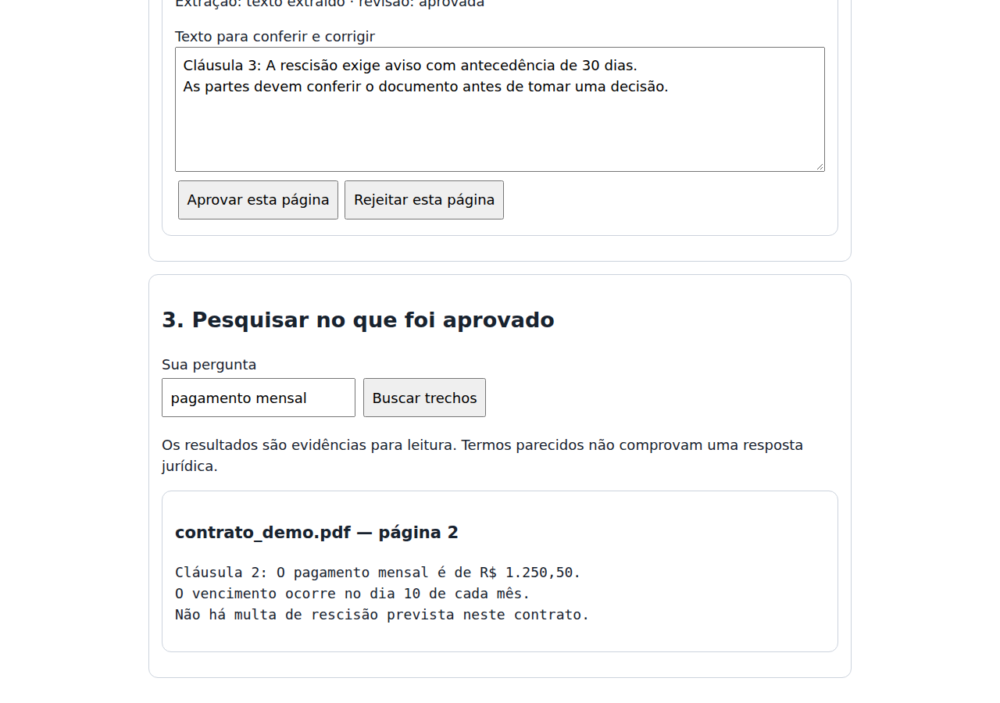

# Demonstração e estudo de caso

[README](../../README.md) · [English overview](../../README_EN.md)

## Problema

Consultar PDFs preservando fonte e revisão humana.

## Decisão de engenharia e contribuição do projeto

Extração por página, hashes e aprovação ligados à versão; só o conteúdo aprovado entra na busca.

A implementação e a avaliação estão no repositório; bibliotecas e motores de terceiros conservam autoria e condições próprias. Este estudo descreve o estágio observado, sem atribuir validação comercial a uma demonstração.

## Entrada → operação → resultado

Siga a sequência de [RECORDING.md](RECORDING.md). A imagem abaixo e o vídeo mostram a interface real, executada localmente com dados fictícios.

[▶ Assistir ao vídeo de aproximadamente 44 segundos](demo.mp4)

Vídeo sem narração; interface em português. Esta é uma demonstração selecionada, não uma homologação E2E completa.

## Resultado verificado

7/7 casos de busca em PDF digital fictício de três páginas. CER/WER normalizados iguais a zero nessa fixture; bloqueio antes da revisão e abstenções conferidos.

- Comando: `python avaliar_pdf.py --strict`.
- Código executado: [`cae6e1e94d2a`](https://github.com/ofelipepeixoto/assistente-documental-ia/tree/cae6e1e94d2ac4e70d10770b75cc52a839e97e3c).
- Ambiente: Linux, Python 3.12.14 para PDF; Node 24.19.0 para aplicações web.
- Reprodução: 11/10/2026 UTC, 10/10/2026 em São Paulo.

## Limites e aprendizado

Não mede scans, tabelas, OCR em GPU, documentos reais ou qualidade jurídica. O revisor é autodeclarado; não há identidade autenticada.

A diferença entre dados pendentes, evidência sintética e resultado validado continua visível. Não foram medidos produtividade, adoção, receita ou satisfação de clientes nesta rodada. Contagens de testes não substituem essas métricas.

## Reproduzir

Use os comandos do [README](../../README.md), apenas fixtures fictícias e a sequência de [RECORDING.md](RECORDING.md). O [guia em inglês](../../README_EN.md) explica entrada, operação, resultado e limites para visitantes internacionais. Não grave dados privados, credenciais ou documentos de clientes.
